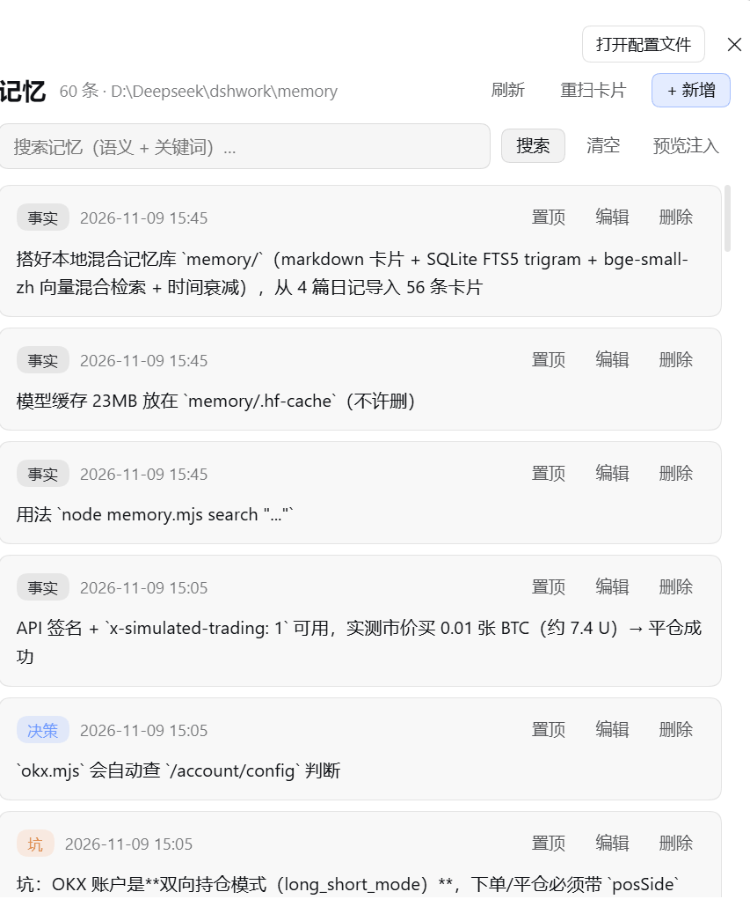
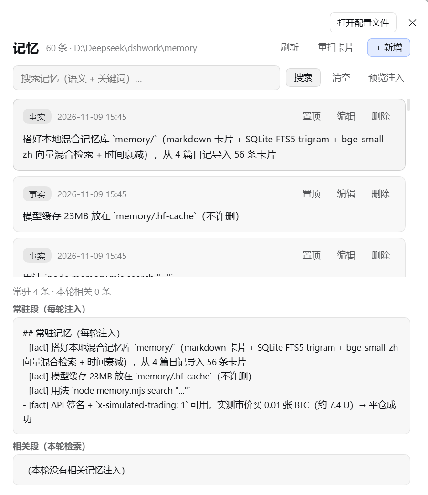
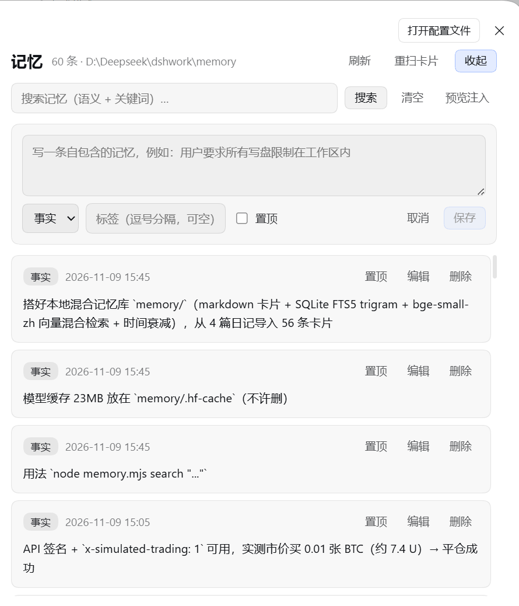

# dsh-memory-mcp

English | [中文](README.md)

**Long-term memory for DeepSeek Harness — and the memory is plain markdown you can actually read.**

One-command install, per-turn memory injection, optional local Chinese embedding search. Your data is never locked inside a database: every memory is a `cards/*.md` file you can read, edit, back up and commit.



*Settings → Memory: cards are listed newest first with type badges, pinned marks and source; each row can be pinned, edited or deleted, and “+ New” opens the compose form.*

<details>
<summary>More screenshots</summary>



*Preview injection: shows the always-on section (injected every turn) and the per-turn relevant section, so you can see exactly what enters the context and whether it is too much.*



*Add a memory: body, type (fact / preference / decision / pitfall), tags, and whether to pin it. Pinned memories are injected every turn.*

</details>

## Install (one command)

```bash
dsh plugin --profile desktop add dsh-memory-mcp
# restart DSH
```

The model gets four tools:

| Tool | Purpose |
|---|---|
| `memory_write` | Store one memory (type / tags / pinned; rejects secret-looking content) |
| `memory_search` | Hybrid search (vector + keyword + time decay) |
| `memory_list` | List recent memories |
| `memory_forget` | Delete a memory |

Import, reindex and stats are maintenance actions, so they live in the settings page and the CLI instead of consuming model-facing tool slots.

**Two layers of injection:**

1. **Always-on**: pinned memories + the 4 most recent ones, capped at 900 characters in the system prompt;
2. **Per-turn relevant**: before each model step the plugin searches memory with the current conversation and injects only hits that clear the bar (requires a lexical overlap or a high-confidence semantic match; max 3 items, 800 characters). Irrelevant turns stay untouched.

## Storage

```
$DSH_HOME/memory-cards/
├─ cards/          memory cards (.md — human readable, hand editable)
└─ index.db        SQLite index (FTS5 + vectors); delete it and it rebuilds
```

Card format:

```markdown
---
id: 02b7eef3589a
type: pitfall
tags: [network, proxy]
ts: 2026-11-09T15:30:00+08:00
pinned: false
---
A dead proxy node makes OKX unreachable; fix the Clash node first.
```

## Optional: Chinese semantic search

Keyword search works with zero dependencies. For semantics, install one extra package into the same profile:

```bash
dsh plugin --profile desktop add @huggingface/transformers
```

After a restart `memory_stats` in the settings page shows semantics enabled; the first search downloads a ~23 MB Chinese embedding model (`bge-small-zh-v1.5`). In mainland China set `HF_ENDPOINT=https://hf-mirror.com` first.

If the package is missing, installation failed, or the model cannot be downloaded, the plugin **silently falls back to keyword search** and keeps starting.

## Configuration

The bundle patch ships defaults; override the row to change them:

```yaml
- id: memory-cards
  name: dsh-memory-mcp
  config:
    path: !!js dshHomePath('memory-cards')
    promptRecentCount: 4      # always-on entries
    promptMaxChars: 900
    injectEnabled: true       # per-turn relevant injection
    injectCount: 3
    injectMinScore: 0.30      # threshold when there is lexical overlap
    injectSemanticMinScore: 0.45  # stricter threshold for semantic-only matches
    injectRelRatio: 0.85
    injectMaxChars: 800
    maxTextChars: 2000
    searchLimitDefault: 8
    searchLimitMax: 30
    rejectSecrets: true
    promptOrder: 50
```

## CLI / MCP (optional)

The same memory is reachable outside DSH:

```bash
dsh-memory search "why did we drop the QQ bridge" 5
dsh-memory add --type preference --tags disk --text "Only write inside the workspace"
dsh-memory import ~/notes/diary     # bulk import markdown diary files
dsh-memory reindex                  # rebuild the index after hand edits
dsh-memory consolidate 0.9          # merge near-duplicate cards
dsh-memory stats
```

An MCP server (`dsh-memory-mcp/mcp`) is included for any MCP-capable client.

## Why not just use an existing memory plugin

Several DSH memory plugins exist; they store data inside SQLite or JSON. This project makes a different trade-off:

| This plugin | Others |
|---|---|
| Markdown is the source of truth | Data lives in SQLite/JSON |
| Sentence-level cards | Whole entries |
| Hybrid retrieval: vector 65% + keyword 25% + literal hit 10%, multiplied by time decay (180-day half-life) | Mostly keyword-only |
| Built-in Chinese embedding (opt-in install) | Often none, or train your own |
| DSH plugin **and** CLI/MCP access to one store | DSH only |

## Known limitations

- Relevant injection depends on retrieval quality; without the embedding package it is keyword-only.
- `consolidate` merges near duplicates only; it does not abstract memories.
- Single user, single store; no multi-tenant support.
- No dedicated settings UI beyond the memory section (that is the current page).

## License

MIT
