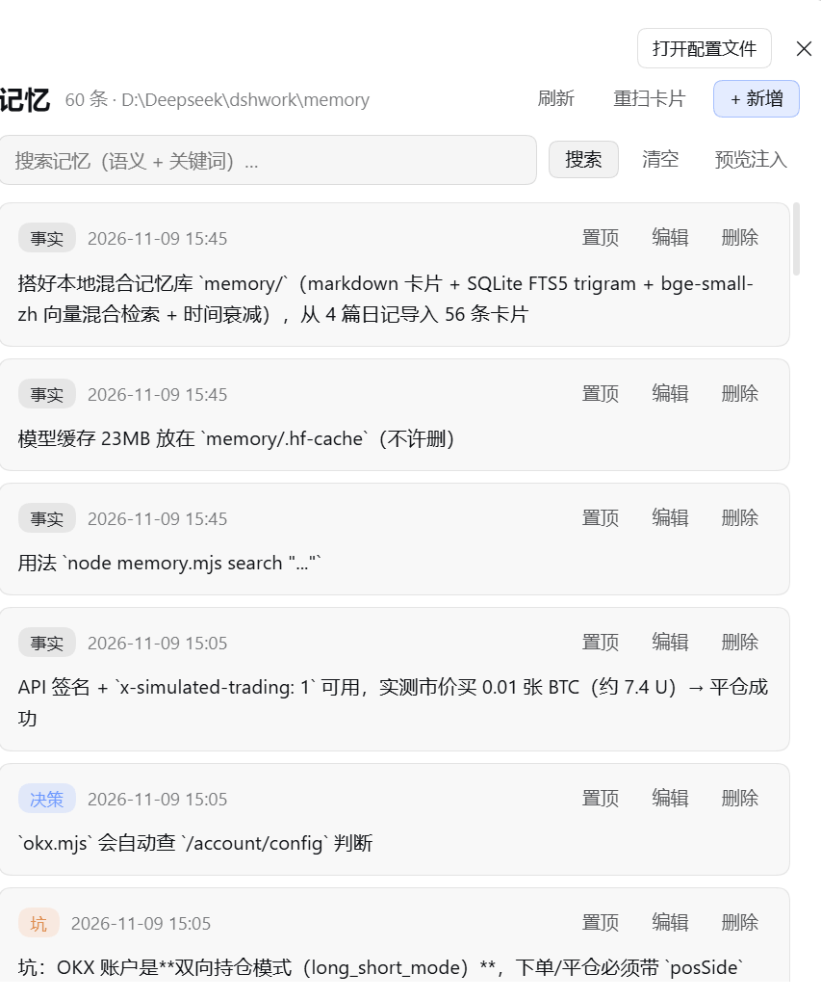
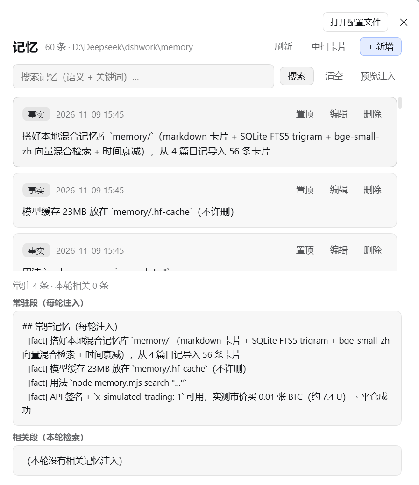
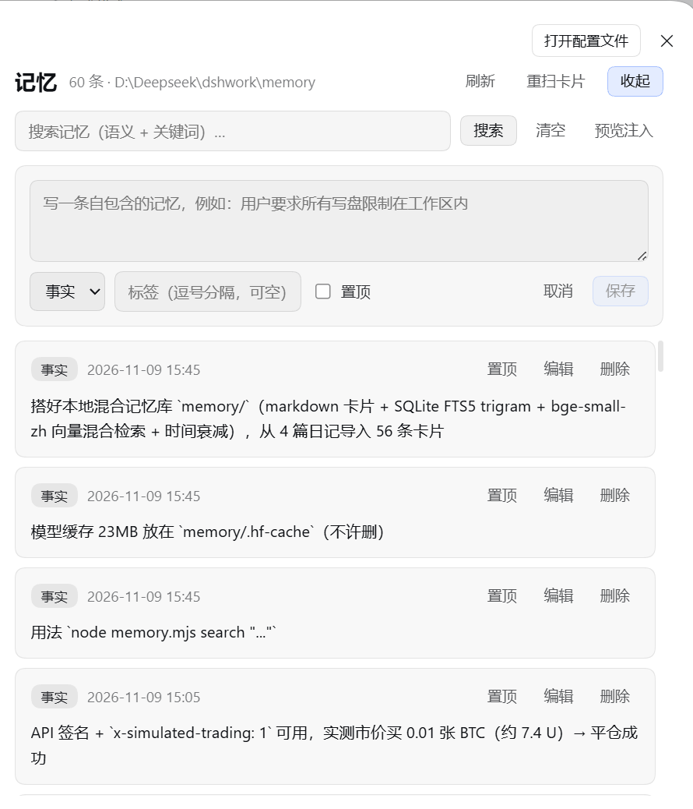

# dsh-memory-mcp

[English](README.en.md) | 中文

**DeepSeek Harness 的长期记忆插件，但记忆是你自己能看见的 markdown 文件。**

一条命令安装、每轮自动注入相关记忆、可选本地中文向量检索。数据不锁在数据库里——每个记忆就是 `cards/*.md`，可以直接读、改、备份、进 git。



*设置 → 记忆：卡片列表按时间倒序，显示类型徽章、置顶标记与来源；支持搜索、编辑、删除，右上角「+ 新增」展开录入表单。*

<details>
<summary>更多截图</summary>



*预览注入：分两段展示「常驻段（每轮注入）」与「相关段（本轮按对话检索）」，可以确认到底往上下文里塞了什么、有没有塞多。*



*新增记忆：正文 + 类型（事实/偏好/决策/坑）+ 标签 + 是否置顶；置顶的记忆每轮都会注入。*

</details>

## 安装（一条命令）

```bash
dsh plugin --profile desktop add dsh-memory-mcp
# 然后重启 DSH
```

装完模型会多出四个工具（导入/校准/统计等运维操作放在设置页和 CLI 里，不占工具位）：

| 工具 | 作用 |
|---|---|
| `memory_write` | 写入一条记忆（type / tags / pinned，拒绝疑似密钥） |
| `memory_search` | 混合检索（向量 + 关键词 + 时间衰减） |
| `memory_list` | 列出最近记忆 |
| `memory_forget` | 删除记忆 |

**两层注入**：

1. **常驻**：置顶记忆 + 最近 6 条，按 1600 字符预算进系统提示；
2. **每轮相关**：每次模型执行前，用当前对话检索记忆，只注入分数 ≥0.25 的（最多 5 条、1200 字符）。不相关的不打扰上下文。

## 存储

```
$DSH_HOME/memory-cards/
├─ cards/          记忆卡片（.md，人可读、可手改）
└─ index.db        SQLite 索引（FTS5 + 向量），删掉会自动重建
```

卡片格式：

```markdown
---
id: 02b7eef3589a
type: pitfall
tags: [网络, 代理]
ts: 2026-11-09T15:30:00+08:00
pinned: false
---
代理节点挂了会导致 OKX 连不上，需要先修好 Clash 节点。
```

## 可选：启用中文语义检索

默认只做关键词检索（零依赖）。想要语义能力，额外装一个包到同一个 profile：

```bash
dsh plugin --profile desktop add @huggingface/transformers
```

重启后 `memory_stats` 会显示「语义检索：已启用」；首次检索会下载约 23MB 的中文向量模型（`bge-small-zh-v1.5`）。国内网络可先设 `HF_ENDPOINT=https://hf-mirror.com`。

没装、装失败、模型下载不下来，都会**静默退回关键词模式**，不影响插件启动。

## 配置

bundle patch 已带默认值；想改可覆盖那一行：

```yaml
- id: memory-cards
  name: dsh-memory-mcp
  config:
    path: !!js dshHomePath('memory-cards')
    promptRecentCount: 6     # 常驻注入条数
    promptMaxChars: 1600
    injectEnabled: true      # 每轮相关注入
    injectCount: 5
    injectMinScore: 0.25     # 相关性门槛
    injectMaxChars: 1200
    maxTextChars: 2000
    searchLimitDefault: 8
    searchLimitMax: 30
    rejectSecrets: true      # 拒绝 sk-/ghp_/npm_/私钥等
    promptOrder: 50
```

## 命令行 / MCP（可选）

同一份记忆也能在 DSH 外面用：

```bash
dsh-memory search "为什么放弃 QQ 接入" 5
dsh-memory add --type preference --tags 磁盘 --text "写盘只能在工作区"
dsh-memory import ~/notes/diary        # 把日记 markdown 批量导入成卡片
dsh-memory reindex                     # 卡片手改后重建索引
dsh-memory consolidate 0.9             # 合并语义重复的卡片
dsh-memory stats
```

也提供 MCP server（`dsh-memory-mcp/mcp`），可挂到任意支持 MCP 的客户端。

## 为什么不用现成的方案

已有几个 DSH 记忆插件，数据存在 SQLite/JSON 里。这个项目的取舍：

| 我们 | 说明 |
|---|---|
| markdown 是真相源 | 索引可重建、数据可读可改、换模型不丢记忆 |
| 句子级卡片 | 整段日记检索噪声大，拆句召回更准 |
| 混合检索 | 向量 65% + 关键词 25% + 原文命中 10%，再乘时间衰减（半衰期 180 天） |
| 中文优先 | 内置 bge-small-zh，FTS5 用 trigram 分词（中文无需分词库） |
| 双入口 | DSH 内是插件，DSH 外是 CLI/MCP，同一份数据 |

## 已知限制

- 相关注入依赖检索质量：语义模式没启用时只按关键词匹配
- `consolidate` 只做近重复合并，不做语义抽象
- 单用户单库，不做多租户
- 没有设置页/可视化面板（v0.3 计划）

## License

MIT

## 设置页

装好后在 **设置 → 记忆**，分两个视图：

**列表**：

- 卡片列表（类型、时间、置顶标记、来源）
- 搜索框（语义 + 关键词）
- 新增 / 编辑 / 删除 / 置顶切换
- **预览注入**：看清下一轮会注入哪些记忆（常驻段 + 相关段），避免"不知道它塞了什么"
- 重扫卡片（手改 `cards/*.md` 后校准索引）

**记忆海**（2D 语义图谱）：

- 每张卡片一个节点，颜色区分类型（事实/偏好/决策/坑），大小按连接数；
- 连线 = **真实语义相似度**（不是关键词），阈值可在界面上滑调（0.50–0.80）；
- 拖拽节点、滚轮缩放、悬停看摘要、点击看全文；
- 没有向量数据时自动退化为「同类型 + 共享标签」连边。

数据仍在 `cards/*.md`，设置页只是同一份数据的另一个入口。